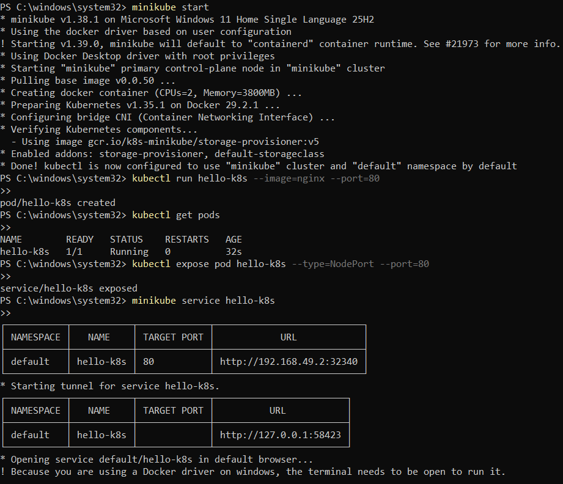

# Kubernetes Basics: Deploying & Exposing a Pod with Minikube

## Overview

A hands-on walkthrough demonstrating how to spin up a single-node local Kubernetes cluster with Minikube, deploy a standalone Nginx web server pod, expose it via a NodePort service, and verify connectivity from the host browser.

---

## Lab Environment

| Component | Detail |
|---|---|
| **Host System** | Windows 11 |
| **Driver / Runtime** | Docker Desktop |
| **Minikube** | v1.38.1 |
| **Kubernetes** | v1.35.1 |
| **Workload Image** | `nginx:latest` |

---

## Step-by-Step Implementation

### 1. Initializing Cluster
Start up the local Minikube environment utilizing Docker as the container driver:

```bash
minikube start --driver=docker
```

Once initialized, `kubectl` context automatically targets the local Minikube cluster.

---

### 2. Spinning Up the Nginx Pod
Create an imperatively managed Pod called `hello-k8s` pulling the official Nginx container image listening on port 80:

```bash
kubectl run hello-k8s --image=nginx --port=80
```

Confirm that the pod transitions into `Running` state with container status `1/1`:

```bash
kubectl get pods -o wide
```

```text
NAME        READY   STATUS    RESTARTS   AGE
hello-k8s   1/1     Running   0          30s
```

Here, the pod has been successfully scheduled and started by the Kubelet on the local Minikube node:



---

### 3. Exposing the Workload via Service
By default, pods receive internal cluster IPs inaccessible outside the cluster. We expose `hello-k8s` externally through a `NodePort` service:

```bash
kubectl expose pod hello-k8s --type=NodePort --port=80
```

Verify the service creation and assigned node port:

```bash
kubectl get svc hello-k8s
```

---

### 4. Accessing the Web Application
Since Minikube runs inside Docker on Windows, use the built-in tunnel utility to bridge network access to the NodePort service:

```bash
minikube service hello-k8s
```

This allocates an accessible local URL and launches the default web browser, confirming the Nginx welcome screen:


---

## Architectural Workflow

When `kubectl run` is executed:
1. **API Server (`kube-apiserver`)**: Authenticates the request and registers the desired pod specification.
2. **Storage (`etcd`)**: Persists the updated cluster state.
3. **Scheduler (`kube-scheduler`)**: Identifies available nodes and assigns `hello-k8s` to the Minikube worker node.
4. **Node Agent (`kubelet`)**: Reads the pod spec assigned to the node and instructs the container runtime (Docker) to pull the image and launch the container.
5. **Networking (`kube-proxy` & Service)**: Configures packet routing so incoming traffic hitting the assigned NodePort forwards to the pod's endpoint.

---

## Quick Reference Summary

```bash
# Start cluster
minikube start

# Create pod
kubectl run hello-k8s --image=nginx --port=80

# Check status
kubectl get pods

# Expose as NodePort service
kubectl expose pod hello-k8s --type=NodePort --port=80

# Open in browser
minikube service hello-k8s
```

---

## Key Takeaways
- Successfully provisioned a Kubernetes pod using imperative commands.
- Understood how Kubernetes services (`NodePort`) abstract and route traffic to underlying ephemeral pods.
- Validated end-to-end request lifecycle from host machine through Minikube ingress to the containerized application.
