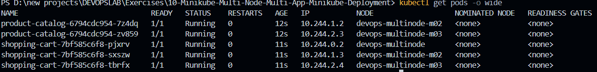

# Multi-Node Kubernetes Clustering: Multi-Service Deployments & Pod Anti-Affinity

## Project Overview

This advanced container orchestration project demonstrates high-availability architecture on a multi-node Kubernetes cluster provisioned via Minikube. 

We deploy two decoupled Python Flask microservices (`Product Catalog` and `Shopping Cart`) across a 3-node cluster, configure hard **Pod Anti-Affinity** policies to ensure replica distribution across separate physical/virtual nodes, expose services via NodePort mappings, and evaluate cluster resilience and fault tolerance during artificial worker node failure.

---

## High-Availability Microservices Scenario

E-commerce architectures require resilient multi-tenant workload distribution to avoid single points of failure (SPOF):

| Microservice | Internal Code | Desired Replicas | Anti-Affinity Rule | Target Placement |
|---|---|---|---|---|
| **Product Catalog** | AppA | 2 Replicas | Hard Anti-Affinity | Distributed across distinct nodes |
| **Shopping Cart** | AppB | 3 Replicas | Hard Anti-Affinity | 1 replica per node across all 3 nodes |

---

## Technical Specifications & Infrastructure

| Layer | Component | Specification |
|---|---|---|
| **Operating System** | Windows 11 | Host environment |
| **Cluster Topology** | Minikube v1.38.1 | Profile: `devops-multinode` (3 Nodes) |
| **Kubernetes Version** | v1.35.1 | Client & Cluster Server |
| **Container Engine** | Docker Desktop | WSL2 Backend Engine |
| **Workload Stack** | Python 3.9 + Flask | REST APIs listening on port 80 |

---

## Step-by-Step Implementation

### 1. Multi-Node Cluster Provisioning
Clear stale cluster configurations and bootstrap a multi-node Minikube cluster:

```powershell
minikube delete --all
minikube start --nodes 3 -p devops-multinode --driver=docker
```

Verify that all three nodes transition into `Ready` state:

```powershell
kubectl get nodes
```

*Output:*
```text
NAME                   STATUS   ROLES           AGE     VERSION
devops-multinode       Ready    control-plane   2m29s   v1.35.1
devops-multinode-m02   Ready    <none>          82s     v1.35.1
devops-multinode-m03   Ready    <none>          48s     v1.35.1
```


---

### 2. Application Architecture & Containerization
The solution deploys two decoupled microservices:

1. **Product Catalog (`product_catalog.py`)**: Exposes `GET /products`, serving catalog inventory.
2. **Shopping Cart (`shopping_cart.py`)**: Exposes `GET /cart` to inspect state and `POST /cart` to add products.

Build container images locally from dedicated Dockerfile specifications:

```powershell
docker build -t product-catalog:latest -f Dockerfile.product .
docker build -t shopping-cart:latest -f Dockerfile.shopping .
docker images
```

---

### 3. Propagating Images Across Cluster Nodes
In multi-node environments, images built on the host Docker daemon are not automatically accessible across remote nodes. Load both images into all cluster nodes:

```powershell
minikube -p devops-multinode image load product-catalog:latest
minikube -p devops-multinode image load shopping-cart:latest
```

Verify presence of images within the Minikube runtime:

```powershell
minikube -p devops-multinode ssh -- docker images
```

The output confirms that `product-catalog:latest` and `shopping-cart:latest` are resident on the node alongside system images (`kube-apiserver`, `coredns`, `etcd`):


---

### 4. Deploying Workloads with Pod Anti-Affinity
Both deployments specify `imagePullPolicy: Never` and declare strict `podAntiAffinity` rules using `topologyKey: "kubernetes.io/hostname"`:

```yaml
affinity:
  podAntiAffinity:
    requiredDuringSchedulingIgnoredDuringExecution:
    - labelSelector:
        matchLabels:
          app: product-catalog
      topologyKey: "kubernetes.io/hostname"
```

> **Design Principle**: `requiredDuringSchedulingIgnoredDuringExecution` strictly forbids the scheduler from placing two pods carrying the same label selector on identical hostnames.

Apply the deployment and service manifests:

```powershell
kubectl apply -f product_catalog_deployment.yaml
kubectl apply -f shopping_cart_deployment.yaml
kubectl apply -f product_catalog_service.yaml
kubectl apply -f shopping_cart_service.yaml
```

---

### 5. Validating Multi-Node Pod Topology
Audit pod scheduling across the cluster nodes:

```powershell
kubectl get pods -o wide
```

*Scheduling Matrix Analysis:*
- **Product Catalog** (2 replicas): Placed on `devops-multinode-m02` and `devops-multinode-m03`.
- **Shopping Cart** (3 replicas): Uniformly distributed across all 3 nodes (`devops-multinode`, `m02`, and `m03`).
- **Status**: Every pod is `Running` (`READY 1/1`) with distinct cluster overlay IPs.



---

### 6. Establishing Ingress Tunnels
Due to Docker driver networking isolation on Windows, expose each NodePort service using Minikube tunnel processes:

**Terminal 2:**
```powershell
minikube -p devops-multinode service product-catalog-service --url
```
*Endpoint:* `http://127.0.0.1:56362`

**Terminal 3:**
```powershell
minikube -p devops-multinode service shopping-cart-service --url
```
*Endpoint:* `http://127.0.0.1:54630`

---

### 7. End-to-End API Integration Testing
From the primary terminal, test endpoints across both microservices:

```powershell
# 1. Fetch catalog items
curl.exe http://127.0.0.1:56362/products

# 2. Query empty cart
curl.exe http://127.0.0.1:54630/cart

# 3. Add item to cart via HTTP POST
Invoke-RestMethod -Method Post -Uri http://127.0.0.1:54630/cart `
  -ContentType "application/json" `
  -Body '{ "id": 1, "name": "Laptop", "quantity": 1 }'

# 4. Verify updated cart contents
curl.exe http://127.0.0.1:54630/cart
```

*Results:*
- `GET /products` returns catalog JSON (`Laptop`, `Phone`, `Headphones`).
- Cart initialized empty (`[]`), successfully ingested `Laptop` (quantity: 1), and persisted state across subsequent queries.


---

### 8. Fault Tolerance & High-Availability Resilience Testing
Simulate hardware/node degradation by stopping worker node `devops-multinode-m02`:

```powershell
minikube -p devops-multinode node stop devops-multinode-m02
```

Audit pod and node status:

```powershell
kubectl get pods -o wide
```

*Fault-Tolerance Observations:*
- Minikube confirms: `Successfully stopped node devops-multinode-m02`.
- Active workloads on `devops-multinode` (control-plane) and `devops-multinode-m03` continue serving traffic seamlessly.
- Kubernetes Node Controller monitors the `NotReady` threshold before initiating evictions (default ~5 minutes), preventing unnecessary churn during transient network drops while remaining nodes maintain application availability.


Restore the worker node:

```powershell
minikube -p devops-multinode node start devops-multinode-m02
```

---

## Architectural Scheduling Pipeline

```text
Deployment Applied (Replicas: 3, podAntiAffinity enabled)
                 │
                 ▼
Kube-Scheduler evaluates Node Predicates & Topologies
                 │
  ┌──────────────┼──────────────┐
  ▼              ▼              ▼
[ Node 1 ]     [ Node 2 ]     [ Node 3 ]
(devops-       (devops-       (devops-
multinode)    multinode-m02) multinode-m03)
  │              │              │
Pod: Cart-1    Pod: Cart-2    Pod: Cart-3
                 │              │
               Pod: Catalog-1 Pod: Catalog-2
```

---

## Consolidated Command Reference

```powershell
# 1. Cluster provisioning
minikube delete --all
minikube start --nodes 3 -p devops-multinode --driver=docker
kubectl get nodes

# 2. Build and distribute container images
docker build -t product-catalog:latest -f Dockerfile.product .
docker build -t shopping-cart:latest -f Dockerfile.shopping .
minikube -p devops-multinode image load product-catalog:latest
minikube -p devops-multinode image load shopping-cart:latest

# 3. Deploy manifests & services
kubectl apply -f product_catalog_deployment.yaml
kubectl apply -f shopping_cart_deployment.yaml
kubectl apply -f product_catalog_service.yaml
kubectl apply -f shopping_cart_service.yaml
kubectl get pods -o wide

# 4. Ingress tunneling
minikube -p devops-multinode service product-catalog-service --url
minikube -p devops-multinode service shopping-cart-service --url

# 5. Fault-tolerance test
minikube -p devops-multinode node stop devops-multinode-m02
kubectl get pods -o wide
minikube -p devops-multinode node start devops-multinode-m02
```

---

## Engineering Notes & Fixes
- **Namespace Normalization**: Normalized deployment metadata to target the `default` namespace rather than uninitialized custom namespaces.
- **Image Distribution Efficiency**: Utilized `minikube image load` across all profile nodes, avoiding unnecessary local Docker registry overhead.
- **PowerShell HTTP Parsing**: Leveraged `curl.exe` for standardized text rendering and `Invoke-RestMethod` for JSON serialization.

---

## Conclusion
Successfully designed, deployed, and tested a resilient multi-node Kubernetes cluster. Enforced strict pod anti-affinity policies guaranteeing fault-isolated replica distribution across three nodes, established NodePort service ingress, and demonstrated continuous application availability during simulated worker node downtime.