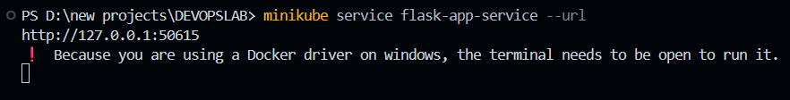

# Containerizing & Deploying a Python Flask Application on Kubernetes (Minikube)

## Overview

This project covers the complete lifecycle of packaging a Python Flask web service into a container image, deploying it on a local Minikube cluster using declarative Kubernetes YAML manifests (Deployment & NodePort Service), and accessing the endpoints through Minikube networking tunnels on Windows.

---

## Technical Specifications & Environment

| Layer | Technology | Details |
|---|---|---|
| **Operating System** | Windows 11 | Host environment |
| **Container Engine** | Docker Desktop | WSL2 backend engine |
| **Local Cluster** | Minikube v1.38.1 | Docker driver |
| **Orchestrator** | Kubernetes v1.35.1 | Client & server |
| **Application Stack** | Python 3.8 + Flask | Custom HTTP microservice |

---

## Detailed Step-by-Step Walkthrough

### 1. Cluster Initialization & Health Check
Provision a local single-node Kubernetes cluster with custom resource allocations (4 vCPUs and 4 GB RAM):

```powershell
minikube start --driver=docker --cpus=4 --memory=4096
minikube status
kubectl cluster-info
```

*Verification:* Confirm the control-plane components (API server, kubelet, etcd) report healthy and that `kubectl` targets the local endpoint (e.g. `https://127.0.0.1:53240`).


---

### 2. Building the Flask Microservice
The web application is implemented in `app.py`. It binds to all available network interfaces (`0.0.0.0`) on port `15000` to ensure external traffic within the pod network can reach it:

```python
from flask import Flask
app = Flask(__name__)

@app.route('/')
def home():
    return "Hello from Flask on Kubernetes!"

if __name__ == '__main__':
    app.run(host='0.0.0.0', port=15000)
```

---

### 3. Container Image Definition (`Dockerfile`)
The container is built using a lightweight `python:3.8-slim` base image to maintain a minimal attack surface and fast startup time:

```dockerfile
FROM python:3.8-slim
WORKDIR /app
COPY . /app
RUN pip install flask
CMD ["python", "app.py"]
```

---

### 4. Directing Docker CLI to Minikube's In-Cluster Engine
To allow Kubernetes to pull the locally built image without needing an external image registry like Docker Hub, point your local PowerShell session directly to Minikube's internal Docker daemon:

```powershell
& minikube docker-env | Invoke-Expression
```

> **Note for Windows PowerShell:** This command is the PowerShell equivalent to Unix `eval $(minikube docker-env)`. Keep in mind this environment variable setup is session-specific.

---

### 5. Compiling the Container Image
Build the image directly inside the Minikube environment:

```powershell
docker build -t flask-app .
```

Docker will execute the build steps, pulling layers, installing Flask, and tagging the resulting artifact as `flask-app:latest` (~136 MB).


---

### 6. Declarative Kubernetes Manifests (`flask-deployment.yaml`)
Both the Deployment and Service definitions are declared in a multi-document YAML specification:

```yaml
apiVersion: apps/v1
kind: Deployment
metadata:
  name: flask-app
spec:
  replicas: 1
  selector:
    matchLabels:
      app: flask-app
  template:
    metadata:
      labels:
        app: flask-app
    spec:
      containers:
      - name: flask-app
        image: flask-app:latest
        imagePullPolicy: Never
        ports:
        - containerPort: 15000
---
apiVersion: v1
kind: Service
metadata:
  name: flask-app-service
spec:
  selector:
    app: flask-app
  ports:
  - port: 15000
    targetPort: 15000
  type: NodePort
```

#### Key Architecture Highlights:
- **`imagePullPolicy: Never`**: Instructs the Kubelet to exclusively look for the image in the local Docker cache and prevent failed remote registry lookups.
- **Port Mapping**: The service maps incoming cluster traffic on `port: 15000` directly to the container's `targetPort: 15000`.
- **`type: NodePort`**: Allocates a high-range static port on every cluster node to expose the service outside the cluster boundary.

---

### 7. Applying Manifests & Verifying Deployment
Validate image availability and apply the manifest to create the cluster resources:

```powershell
# Confirm local image presence
docker images | Select-String "flask-app"

# Apply the combined manifest
kubectl apply -f flask-deployment.yaml

# Verify resource statuses
kubectl get deployments
kubectl get pods -l app=flask-app
kubectl get services
```

*Expected Status:*
- **Deployment**: `flask-app` showing `1/1` available replicas.
- **Pod**: Status transitioning to `Running`.
- **Service**: `flask-app-service` created with a NodePort mapping (e.g., `15000:31331/TCP`).


---

### 8. Routing Traffic & Accessing Application
Because Minikube on Windows with the Docker driver isolates container networking within a virtual bridge, NodePorts cannot be hit directly via `localhost`. Instead, establish a network proxy tunnel:

```powershell
minikube service flask-app-service --url
```

*Output:*
```text
http://127.0.0.1:50615
! Because you are using a Docker driver on windows, the terminal needs to be open to run it.
```

> Keep this terminal session active to maintain the tunnel open.



From a **second terminal**, send an HTTP GET request to verify responsiveness:

```powershell
curl.exe http://127.0.0.1:50615
```

*Response:*
```text
Hello from Flask on Kubernetes!
```


---

## Request Flow & Cluster Architecture

```text
User Request (curl.exe)
   ↓
Minikube Host Tunnel (127.0.0.1:50615)
   ↓
NodePort Service (Routing to targetPort: 15000)
   ↓
Pod Selector (app=flask-app)
   ↓
Flask Container Instance
```

1. **Submission**: `kubectl apply` posts the declared state to `kube-apiserver`.
2. **Persistence**: `etcd` logs the deployment state and desired replica count.
3. **Scheduling**: `kube-scheduler` selects the node to run the pod.
4. **Execution**: The node's `kubelet` reads the spec, verifies `imagePullPolicy: Never`, and initiates container creation via Docker.
5. **Networking**: `kube-proxy` writes routing rules connecting the NodePort service to the running container port.
6. **Ingress Tunneling**: `minikube service` creates a host-level port-forward to bridge traffic seamlessly into the cluster.

---

## Consolidated Command Reference

```powershell
# 1. Cluster setup
minikube start --driver=docker --cpus=4 --memory=4096
minikube status
kubectl cluster-info

# 2. Local image build
& minikube docker-env | Invoke-Expression
docker build -t flask-app .

# 3. Deploy manifests
kubectl apply -f flask-deployment.yaml
kubectl get deployments
kubectl get pods -l app=flask-app
kubectl get services

# 4. Ingress & Verification
minikube service flask-app-service --url
curl.exe http://127.0.0.1:50615
```

---

## Troubleshooting & Engineering Insights

- **PowerShell vs. Bash Environment Binding**: `eval $(minikube docker-env)` fails in PowerShell. The correct command on Windows is `& minikube docker-env | Invoke-Expression`.
- **PowerShell `curl` Alias**: Native PowerShell aliases `curl` to `Invoke-WebRequest`. Explicitly calling `curl.exe` guarantees standardized text output.
- **Handling `K8S_APISERVER_MISSING` / Startup Failures**: If the control plane fails during startup, run `minikube delete` to clear dangling state, verify Docker Desktop health with `docker info`, and re-run with explicit resource parameters.
- **Windows Docker Driver Limitations**: NodePort ports are not directly bound to `localhost` when using the Docker driver on Windows. Always use `minikube service <service-name> --url` to expose endpoints.
- **Working Directory Scope**: `docker build` and `kubectl apply -f` must be executed within the directory containing the relevant `Dockerfile` and YAML files.

---

## Summary of Results
The Python Flask service was containerized using Docker, registered inside Minikube's local container engine, deployed via declarative Kubernetes specifications, and accessed through a verified service tunnel, returning HTTP 200 with message: **"Hello from Flask on Kubernetes!"**