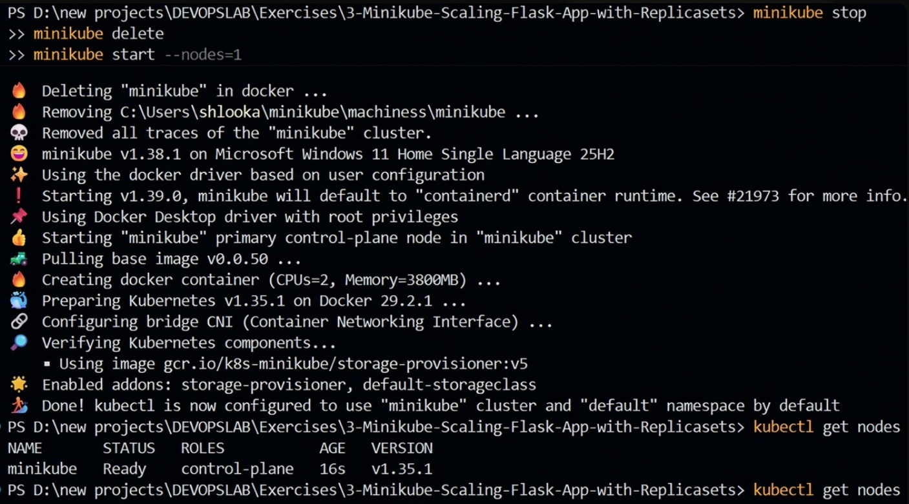
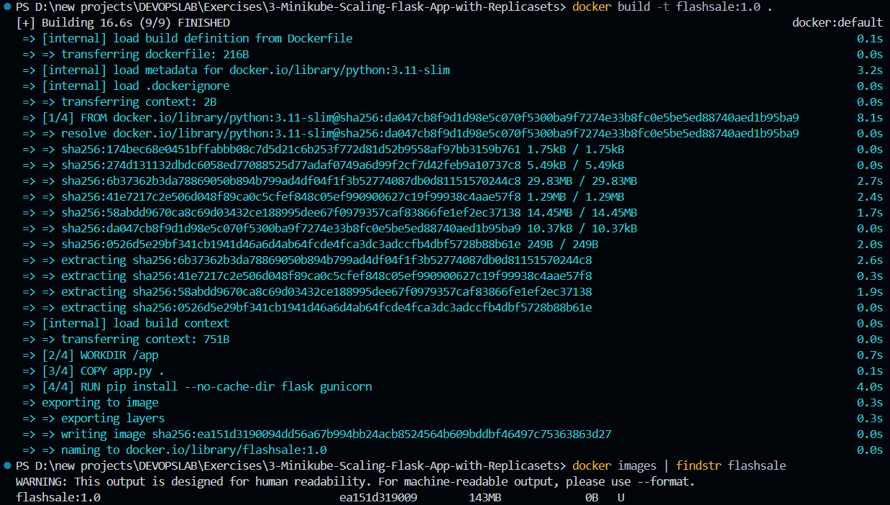
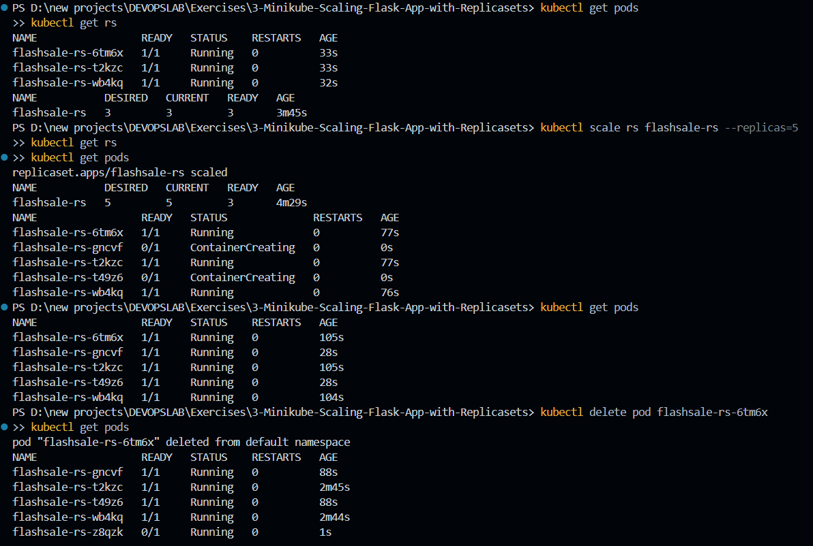
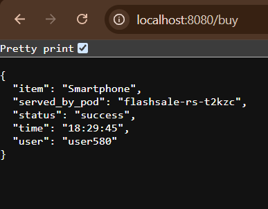
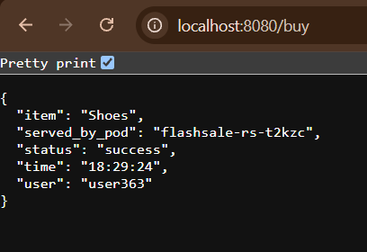

# Scalable Microservices with Kubernetes ReplicaSets & Self-Healing

## Project Overview

This project explores horizontal scaling and automated self-healing in Kubernetes using ReplicaSets. Using a containerized Python Flask e-commerce service ("Flash Sale Simulation"), we observe how Kubernetes dynamically provisions additional pod replicas during high-traffic surges, replaces crashed/deleted pods automatically to maintain desired state, and distributes HTTP requests via an internal ClusterIP Service.

---

## Practical Context: E-Commerce Surge Traffic Handling

Modern high-concurrency systems (such as Flipkart Big Billion Days, Amazon Prime Day, or flash ticket drops) experience rapid traffic spikes where baseline traffic jumps 100x within seconds. Running workloads on single pods risks total service collapse under resource exhaustion. 

Kubernetes ReplicaSets mitigate this vulnerability by ensuring a declared number of identical, healthy pod replicas run concurrently. When traffic normalizes, workloads can be downscaled seamlessly to conserve infrastructure costs.

---

## System Configuration & Prerequisites

| Dimension | Environment Value |
|---|---|
| **Operating System** | Windows 11 |
| **Cluster Orchestration** | Minikube v1.38.1 (Single-Node) |
| **Kubernetes Version** | v1.35.1 |
| **Container Engine** | Docker Desktop (WSL2 Backend) |
| **Application Runtime** | Python (Flask Web Framework) |

---

## Step-by-Step Implementation

### 1. Fresh Cluster Provisioning
Clear previous runtime caches and bring up an isolated single-node Minikube cluster:

```bash
minikube stop
minikube delete
minikube start --nodes=1
kubectl get nodes
```

*Verification:* Ensure the single control-plane node reports `Ready`:

```text
NAME       STATUS   ROLES           AGE   VERSION
minikube   Ready    control-plane   1m    v1.35.1
```



---

### 2. Configuring In-Cluster Docker Daemon Context
Direct the PowerShell session's Docker CLI to communicate directly with Minikube's built-in container runtime, avoiding unnecessary remote registry round-trips:

```powershell
& minikube -p minikube docker-env | Invoke-Expression
docker images
```

Confirm connection to Minikube's Docker runtime by checking default internal images:

```text
gcr.io/k8s-minikube/storage-provisioner:v5   6e38f40d628d   31.5MB
registry.k8s.io/coredns/coredns:v1.13.1      aa5e3ebc0dfe   78.1MB
registry.k8s.io/kube-apiserver:v1.35.1       6f9eeb0cff98   98.8MB
```


---

### 3. Packaging the Flask Microservice
With the session targeted to the Minikube Docker environment, build and tag the container image locally:

```powershell
docker build -t flashsale:1.0 .
docker images | findstr flashsale
```

*Build Artifact Confirmed:*

```text
flashsale:1.0   ea151d319009   143MB
```



---

### 4. Declarative Manifest Specification (`flashsale-replicaset.yaml`)
Create the manifest configuring both the `ReplicaSet` (with health probes and resource boundaries) and a `ClusterIP` Service:

```yaml
apiVersion: apps/v1
kind: ReplicaSet
metadata:
  name: flashsale-rs
  labels:
    app: flashsale
spec:
  replicas: 3
  selector:
    matchLabels:
      app: flashsale
  template:
    metadata:
      labels:
        app: flashsale
    spec:
      containers:
      - name: flashsale-container
        image: flashsale:1.0
        imagePullPolicy: Never
        ports:
        - containerPort: 5000
        readinessProbe:
          httpGet:
            path: /health
            port: 5000
          initialDelaySeconds: 2
          periodSeconds: 5
        livenessProbe:
          httpGet:
            path: /health
            port: 5000
          initialDelaySeconds: 10
          periodSeconds: 10
        resources:
          requests:
            cpu: "100m"
            memory: "128Mi"
          limits:
            cpu: "500m"
            memory: "256Mi"
---
apiVersion: v1
kind: Service
metadata:
  name: flashsale-svc
spec:
  selector:
    app: flashsale
  ports:
  - name: http
    port: 80
    targetPort: 5000
  type: ClusterIP
```

Apply the unified manifest:

```powershell
kubectl apply -f flashsale-replicaset.yaml
```

```text
replicaset.apps/flashsale-rs created
service/flashsale-svc created
```

---

### 5. Dynamic Scaling & Self-Healing Validation
Simulate traffic expansion by scaling from 3 to 5 replicas, and subsequently trigger an artificial pod outage to verify automated remediation:

```powershell
# Inspect initial replicas
kubectl get rs
kubectl get pods

# Scale workload out to 5 replicas
kubectl scale rs flashsale-rs --replicas=5
kubectl get rs
kubectl get pods

# Simulate pod crash/failure by deleting one pod
kubectl delete pod flashsale-rs-6tm6x
kubectl get pods
```

*Observations:*
1. The ReplicaSet instantly recognized the updated replica count and spawned 2 additional pods, reaching all 5 in `Running` state:
   ```text
   flashsale-rs-gncvf   Running
   flashsale-rs-t2kzc   Running
   flashsale-rs-t49z6   Running
   flashsale-rs-wb4kq   Running
   flashsale-rs-z8qzk   Running
   ```
2. When `flashsale-rs-6tm6x` was deleted, the ReplicaSet controller's reconciliation loop detected `actual (4) < desired (5)` and instantly spun up a healthy replacement pod.



---

### 6. Pod IP Allocation & Port Forwarding
Inspect the internal network allocations and establish port forwarding to bridge host requests to the `ClusterIP` Service:

```powershell
kubectl get pods -o wide
kubectl port-forward svc/flashsale-svc 8080:80
```

All 5 pods received unique internal overlay network IPs (`10.244.0.9` through `10.244.0.13`) assigned on the node. The port-forward bridge established active local forwarding:

```text
Forwarding from 127.0.0.1:8080 -> 80
Handling connection for 8080
```


---

### 7. Verifying Distributed Traffic Routing (`/buy` Endpoint)
Send concurrent test requests using PowerShell's `Invoke-RestMethod` to verify that transactions are processed across the running pod instances:

```powershell
Invoke-RestMethod http://localhost:8080/buy
```

**Transaction Sample 1 (Pod `flashsale-rs-t2kzc`):**
```json
{
  "item": "Shoes",
  "served_by_pod": "flashsale-rs-t2kzc",
  "status": "success",
  "time": "18:29:24",
  "user": "user363"
}
```


**Transaction Sample 2 (Pod `flashsale-rs-t2kzc`):**
```json
{
  "item": "Smartphone",
  "served_by_pod": "flashsale-rs-t2kzc",
  "status": "success",
  "time": "18:29:45",
  "user": "user580"
}
```


---

## Control Plane Reconciliation Architecture

```text
Client Request (kubectl scale / delete)
       ↓
kube-apiserver (API Endpoint)
       ↓
etcd (Persists Desired State: 5 Replicas)
       ↓
ReplicaSet Controller (Reconciliation Loop: Desired vs. Actual)
       ↓
kube-scheduler (Assigns unassigned pods to Minikube node)
       ↓
Kubelet (Reads pod specs, invokes container runtime)
       ↓
Container Runtime (Executes flashsale:1.0 containers with health checks)
       ↓
ClusterIP Service (Routes incoming port 8080 traffic across active pods)
```

- **Continuous Reconciliation**: The ReplicaSet controller continuously verifies current cluster state against `spec.replicas`.
- **Health Probing**: Liveness and readiness probes ensure traffic routes only to operational instances.
- **Service Abstraction**: Downstream consumers send requests to a single Service IP/port without tracking dynamic pod IPs.

---

## Complete Command Summary

```powershell
# 1. Environment initialization
minikube stop
minikube delete
minikube start --nodes=1
kubectl get nodes

# 2. Docker daemon context switch & build
& minikube -p minikube docker-env | Invoke-Expression
docker images
docker build -t flashsale:1.0 .
docker images | findstr flashsale

# 3. Deploy ReplicaSet & Service
kubectl apply -f flashsale-replicaset.yaml
kubectl get rs
kubectl get pods

# 4. Scaling and resilience testing
kubectl scale rs flashsale-rs --replicas=5
kubectl delete pod flashsale-rs-6tm6x
kubectl get pods -o wide

# 5. Local ingress & transaction testing
kubectl port-forward svc/flashsale-svc 8080:80
Invoke-RestMethod http://localhost:8080/buy
```

---

## Results & Conclusions
- Deployed a multi-replica Python Flask service managed declaratively via Kubernetes ReplicaSets.
- Confirmed horizontal scalability by adjusting replica counts dynamically from 3 to 5 with zero downtime.
- Validated high-availability self-healing as the control plane immediately restored desired capacity following simulated pod termination.
- Established local connectivity via `kubectl port-forward` and verified request resolution across container instances.