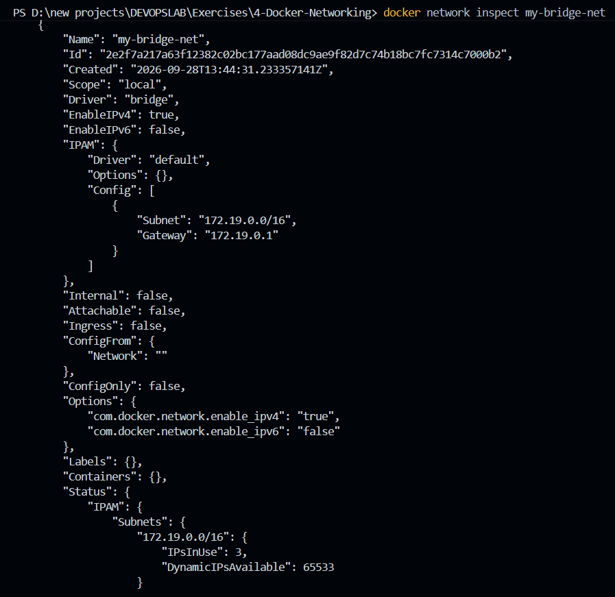
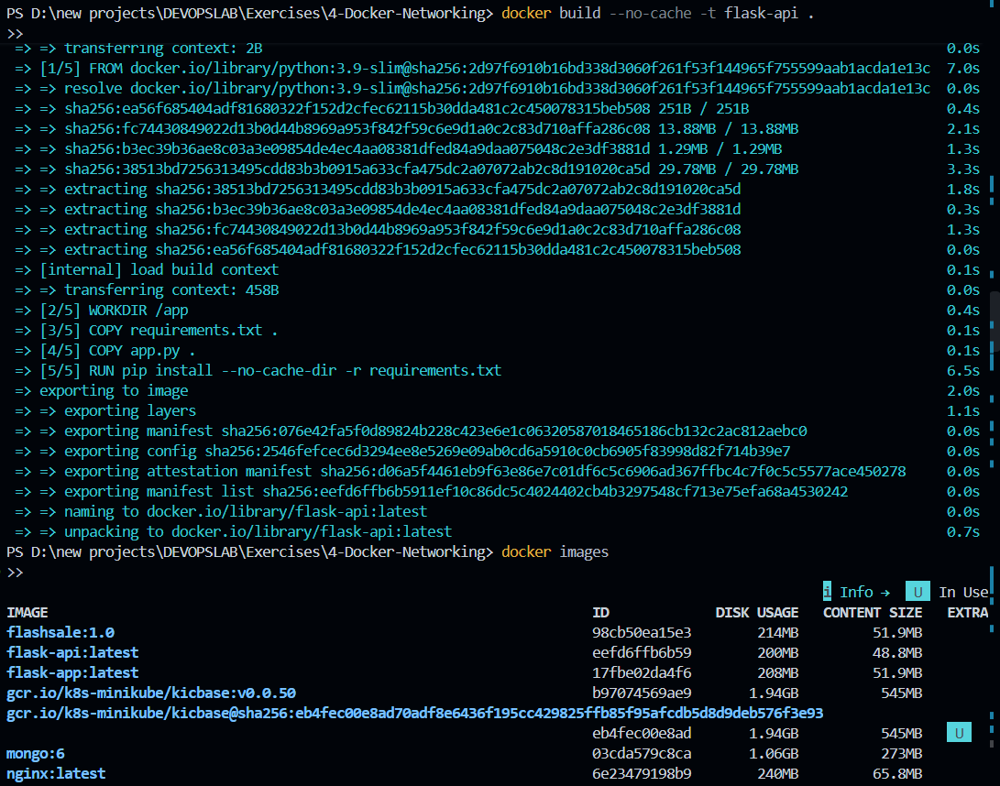
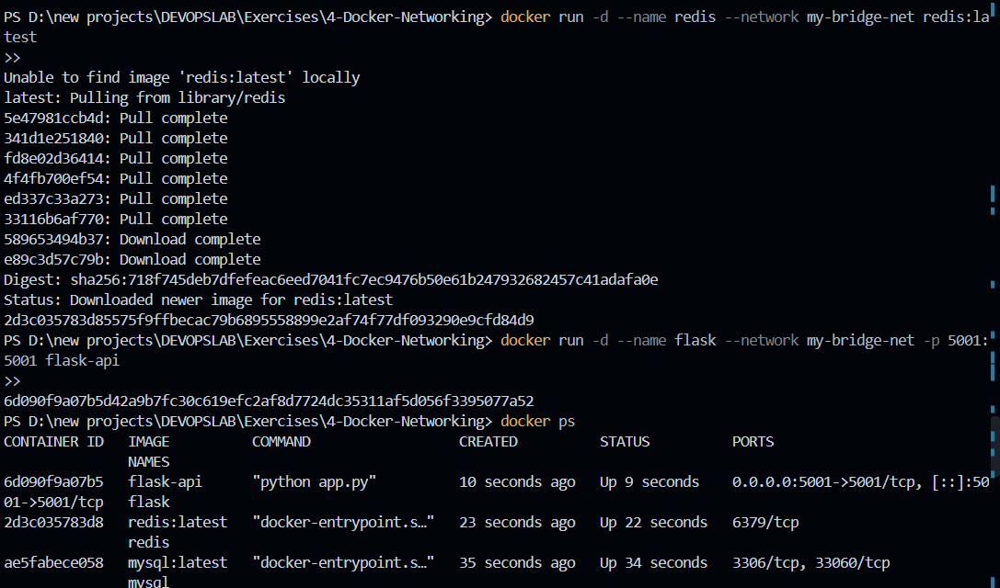
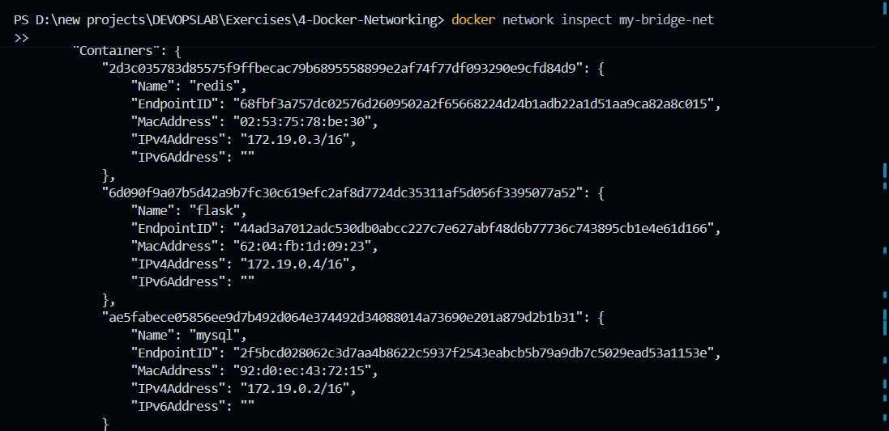
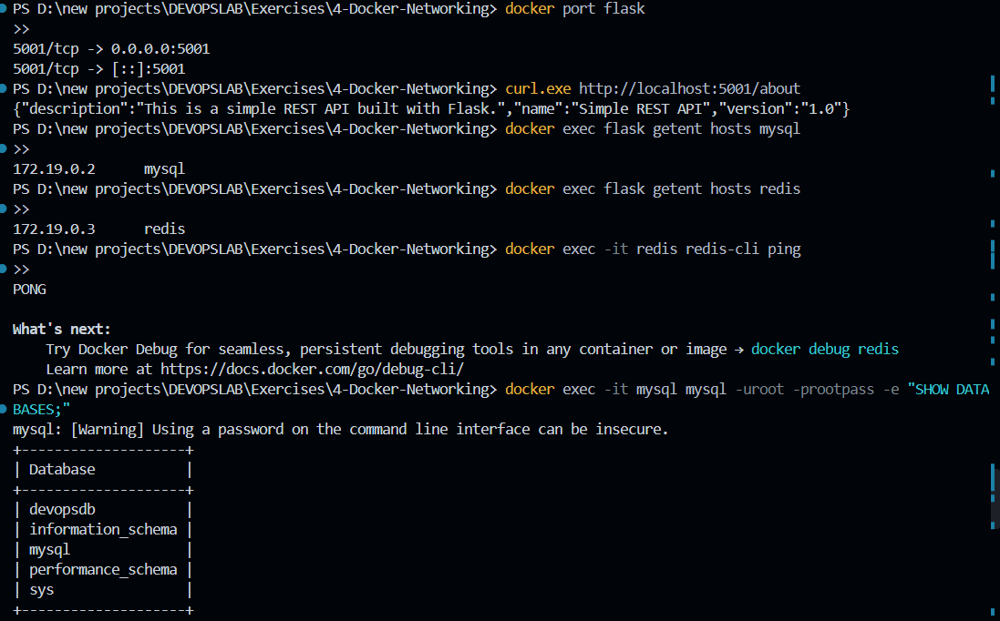
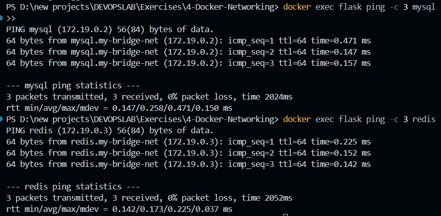

# Multi-Tier Container Architecture & Docker Bridge Networking

## Project Overview

This project demonstrates container networking patterns in Docker by deploying a multi-tier microservice architecture consisting of a Python Flask REST API, a MySQL relational database, and a Redis in-memory cache. 

Using an isolated user-defined Docker bridge network, containers communicate directly using Docker's embedded DNS service discovery without exposing internal backend ports to the host system.

---

## Technical Specifications

| Layer | Component | Configuration |
|---|---|---|
| **Host System** | Windows 11 | PowerShell / VS Code terminal |
| **Container Engine** | Docker Desktop | Linux container subsystem |
| **API Tier** | Python 3.9 + Flask | `flask-api:latest` (Exposed on `5001`) |
| **Database Tier** | MySQL Server | `mysql:latest` (Database: `devopsdb`) |
| **Cache Tier** | Redis Server | `redis:latest` (Internal port `6379`) |
| **Network** | `my-bridge-net` | User-defined bridge driver |

---

## Network Architecture & Traffic Isolation

```text
                        Host Machine (Browser / curl.exe)
                                       │
                              http://localhost:5001
                                       │
                                       ▼
                       ┌───────────────────────────────┐
                       │    Flask Web Application      │
                       │     (Container: flask)        │
                       │     Host Port Map: 5001:5001  │
                       └───────────────┬───────────────┘
                                       │
                        User-Defined Bridge Network
                             (my-bridge-net)
                                       │
             ┌─────────────────────────┴─────────────────────────┐
             ▼                                                   ▼
┌─────────────────────────┐                         ┌─────────────────────────┐
│     MySQL Database      │                         │       Redis Cache       │
│   (Container: mysql)    │                         │   (Container: redis)    │
│  Internal Port: 3306    │                         │  Internal Port: 6379    │
│  (No host port binding) │                         │  (No host port binding) │
└─────────────────────────┘                         └─────────────────────────┘
```

- **Host-to-Container Ingress**: Only the frontend Flask container publishes port `5001` to the host machine.
- **Inter-Container Communication**: MySQL and Redis remain completely unexposed to the host network. All internal communication occurs within `my-bridge-net` using Docker's internal DNS resolver (`mysql` and `redis`).

---

## Step-by-Step Implementation

### 1. Provisioning the User-Defined Bridge Network
Create an isolated bridge network to provide automatic name-based service discovery between containers:

```powershell
docker network create --driver bridge my-bridge-net
docker network ls
```

*Verification:* The network `my-bridge-net` is listed among default networks (`bridge`, `host`, `none`):


---

### 2. Inspecting Bridge Network Subnet Topology
Examine the subnet allocation and gateway assigned by Docker:

```powershell
docker network inspect my-bridge-net
```

*Key Parameters:*
- **Driver**: `bridge`
- **Subnet**: `172.19.0.0/16` (allocated dynamically by Docker daemon)
- **Gateway**: `172.19.0.1`

> Avoid hard-coding container IP addresses in application configurations; always rely on container hostnames.



---

### 3. Application Artifacts Configuration

#### `app.py`
A lightweight Flask REST service binding to `0.0.0.0` on port `5001` so that requests routed through the container bridge interface are accepted:

```python
from flask import Flask, jsonify

app = Flask(__name__)

@app.route('/about', methods=['GET'])
def about():
    return jsonify({
        "name": "Simple REST API",
        "version": "1.0",
        "description": "This is a simple REST API built with Flask."
    })

if __name__ == '__main__':
    app.run(host='0.0.0.0', port=5001)
```

#### `requirements.txt`
```text
Flask==2.0.1
Werkzeug==2.0.3
```
> **Dependency Pinning Note:** `Werkzeug` is locked to `2.0.3` to guarantee compatibility with `Flask 2.0.1` and avoid breaking API changes found in newer releases.

#### `Dockerfile`
```dockerfile
FROM python:3.9-slim

WORKDIR /app

COPY requirements.txt .
COPY app.py .

RUN pip install --no-cache-dir -r requirements.txt

EXPOSE 5001

CMD ["python", "app.py"]
```

---

### 4. Building the API Container Image
Build the image locally without using layer caches:

```powershell
docker build --no-cache -t flask-api .
docker images
```

Confirm that `flask-api:latest` is successfully compiled and present:



---

### 5. Standalone Smoke Test & MySQL Deployment

Run a preliminary test on the Flask container independently to confirm application sanity:

```powershell
docker run -d --name flask-test -p 5001:5001 flask-api
docker ps
curl.exe http://localhost:5001/about
```

*Response:*
```json
{"description":"This is a simple REST API built with Flask.","name":"Simple REST API","version":"1.0"}
```

Tear down the test container to free the port and deploy MySQL directly on `my-bridge-net`:

```powershell
docker rm -f flask-test

docker run -d --name mysql --network my-bridge-net -e MYSQL_ROOT_PASSWORD=rootpass -e MYSQL_DATABASE=devopsdb mysql:latest
```


---

### 6. Launching Redis Cache & Production Flask API
Attach the Redis cache and production Flask container to `my-bridge-net`:

```powershell
docker run -d --name redis --network my-bridge-net redis:latest

docker run -d --name flask --network my-bridge-net -p 5001:5001 flask-api

docker ps
```

All three containers run concurrently, with only `flask` publishing port `5001` externally:



---

### 7. Verifying In-Network IP Allocations
Inspect `my-bridge-net` to verify attached endpoints:

```powershell
docker network inspect my-bridge-net
```

*Allocated Network Endpoints:*
| Container Name | IPv4 Address | Role |
|---|---|---|
| `mysql` | `172.19.0.2` | Relational Database |
| `redis` | `172.19.0.3` | In-Memory Cache |
| `flask` | `172.19.0.4` | Application API Gateway |



---

### 8. Validating Port Forwarding, DNS Resolution & Services
Execute an end-to-end verification suite:

```powershell
# 1. Check host port mapping
docker port flask

# 2. Query HTTP endpoint via host
curl.exe http://localhost:5001/about

# 3. Test embedded DNS resolution from Flask container
docker exec flask getent hosts mysql
docker exec flask getent hosts redis

# 4. Confirm backend service responsiveness
docker exec -it redis redis-cli ping
docker exec -it mysql mysql -uroot -prootpass -e "SHOW DATABASES;"
```

*Verified Outcomes:*
- `docker port flask` maps `5001/tcp -> 0.0.0.0:5001`.
- API successfully responds with JSON payload.
- Embedded DNS correctly resolves `mysql` → `172.19.0.2` and `redis` → `172.19.0.3`.
- Redis responds with `PONG`.
- MySQL displays cluster databases (`devopsdb`, `information_schema`, `mysql`, `sys`).



---

### 9. Network Layer ICMP Connectivity Validation
Install diagnostic tools in the slim container and verify low-latency packet routing across containers:

```powershell
docker exec flask bash -c "apt-get update && apt-get install -y iputils-ping"
docker exec flask ping -c 3 mysql
docker exec flask ping -c 3 redis
```

*Results:*
- `ping -c 3 mysql`: 3 packets transmitted, 3 received, 0% loss (avg latency ~0.25 ms).
- `ping -c 3 redis`: 3 packets transmitted, 3 received, 0% loss (avg latency ~0.17 ms).



---

## Core Networking Concepts & Observations

```text
External Access:
Host Browser ───────► localhost:5001 ───────► Flask Container (Port Published)

Internal Communication:
Flask ──────────────► DNS: "mysql" ─────────► MySQL Container (Port 3306 Internal)
Flask ──────────────► DNS: "redis" ─────────► Redis Container (Port 6379 Internal)
```

1. **User-Defined vs. Default Bridge**:
   - Default `bridge` network does not offer automatic container-name resolution; it requires manual `--link` flags.
   - User-defined bridge networks incorporate an automatic embedded DNS server (`127.0.0.11`) enabling seamless name resolution.
2. **Security through Isolation**:
   - Databases and caches should never bind ports to `0.0.0.0` on the host unless strictly necessary for external administration. Restricting them to an internal bridge provides strong network isolation.

---

## Complete Command Reference

```powershell
# 1. Network setup
docker network create --driver bridge my-bridge-net
docker network ls
docker network inspect my-bridge-net

# 2. Build image
docker build --no-cache -t flask-api .
docker images

# 3. Test and deploy containers
docker run -d --name flask-test -p 5001:5001 flask-api
curl.exe http://localhost:5001/about
docker rm -f flask-test

docker run -d --name mysql --network my-bridge-net -e MYSQL_ROOT_PASSWORD=rootpass -e MYSQL_DATABASE=devopsdb mysql:latest
docker run -d --name redis --network my-bridge-net redis:latest
docker run -d --name flask --network my-bridge-net -p 5001:5001 flask-api
docker ps

# 4. Service verification & diagnostics
docker port flask
docker exec flask getent hosts mysql
docker exec flask getent hosts redis
docker exec -it redis redis-cli ping
docker exec -it mysql mysql -uroot -prootpass -e "SHOW DATABASES;"

docker exec flask bash -c "apt-get update && apt-get install -y iputils-ping"
docker exec flask ping -c 3 mysql
docker exec flask ping -c 3 redis
```

---

## Teardown & Resource Cleanup

```powershell
docker stop mysql redis flask
docker rm mysql redis flask
docker network rm my-bridge-net
docker rmi flask-api
```

---

## Key Results
Successfully configured a multi-container environment on a custom Docker bridge network. Demonstrated host-to-container port publishing for the web application while maintaining complete network isolation for backend database and caching services. Validated container discovery and sub-millisecond network communication purely through container hostnames.