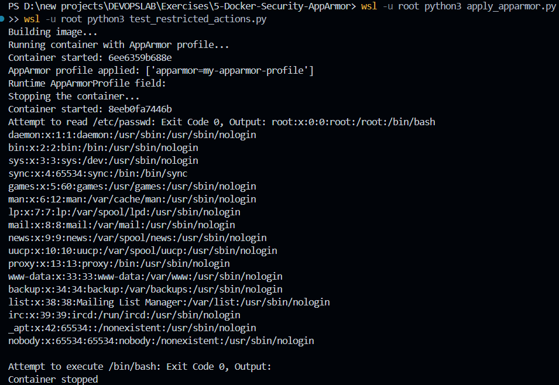

# Container Hardening & Mandatory Access Control via Docker AppArmor

## Executive Summary

This security lab demonstrates container isolation hardening using Linux Mandatory Access Control (MAC) via AppArmor. We develop a restrictive security profile to limit system calls, restrict sensitive directory access (`/etc`, `/var`), and forbid execution of system binaries (`/bin`, `/usr/bin`) for a Python Flask application container. 

The profile is loaded into the Linux kernel and attached to the container using both the native Docker CLI and programmatic orchestration via the Docker SDK for Python.

---

## Lab Environment & Tooling

| Dimension | Specification |
|---|---|
| **Host System** | Windows 11 with WSL2 (Ubuntu 22.04 LTS) |
| **Container Engine** | Docker Engine (native Linux daemon inside WSL2) |
| **Base Image** | `python:3.8-slim` |
| **Application Layer** | Python 3.8 / Flask HTTP server |
| **Kernel Security Framework** | Linux AppArmor (`apparmor-utils`) |
| **Automation Tooling** | Docker SDK for Python (`docker` PyPI package) |

---

## Workspace Structure & Artifacts

The project repository comprises application code, declarative container definitions, the custom security profile, and automated test runners:

```powershell
Get-ChildItem
```

```text
app.py
apply_apparmor.py
Dockerfile
my-apparmor-profile
test_restricted_actions.py
```


---

## Security Policy Design: `my-apparmor-profile`

The custom policy defines least-privilege boundary rules for the Flask service:

1. **Networking Capabilities**: Permits IPv4 TCP network connectivity and grants `net_bind_service` to bind the service to port `5000`.
2. **Privilege Demotion**: Explicitly denies dangerous system capabilities including `capability sys_admin`.
3. **Filesystem Confinement**:
   - Permits read/write/execution access to the application directory (`/app/**`).
   - Grants read access to core Python standard runtime libraries and dynamic linker dependencies.
   - **Explicit Denials**: Blocks reads and writes to credential databases (`/etc/passwd`, `/etc/shadow`), locks down `/etc` against write modifications, and prevents any access to `/var/**`.
4. **Binary Execution Restrictions**: Denies execution rights across system shell paths (`/bin/**`, `/usr/bin/**`, `/sbin/**`), preventing attackers from invoking shell environments (`/bin/sh`, `/bin/bash`) in the event of Remote Code Execution (RCE).

> **Profile Compatibility Refinements**:
> - The profile identifier was normalized to `my-apparmor-profile` rather than a path-based identifier to ensure compatibility with Docker's `--security-opt apparmor=my-apparmor-profile`.
> - Rules were carefully scoped to permit Python's prerequisite shared libraries while locking down general system directories.

---

## Step-by-Step Implementation

### 1. Ingesting Policy into Kernel & Building Container
Copy the profile into the system AppArmor configuration directory, parse and compile it into the Linux kernel, and build the target image:

```powershell
wsl -u root bash -c "cp my-apparmor-profile /etc/apparmor.d/my-apparmor-profile && apparmor_parser -r /etc/apparmor.d/my-apparmor-profile"
wsl -u root bash -c "aa-status | grep my-apparmor-profile"
wsl -u root bash -c "docker build -t flask-apparmor ."
```

*Verification:* `aa-status` confirms that `my-apparmor-profile` is successfully registered in the kernel policy list:


The container image compilation completes, tagging `flask-apparmor:latest` with port `5000` exposed and entrypoint set:


---

### 2. Launching the Profiled Container via Docker CLI
Execute the container with the security profile attached via `--security-opt`:

```powershell
wsl -u root bash -c "docker run -d --name flask-secure --security-opt apparmor=my-apparmor-profile -p 5000:5000 flask-apparmor"
Start-Sleep -Seconds 3
wsl -u root bash -c "curl -s localhost:5000"
wsl -u root bash -c "docker inspect flask-secure --format '{{.AppArmorProfile}}'"
```

*Observations:*
- HTTP probe confirms the service is operational:
  ```text
  Hello, this is a secure Flask application running inside a Docker container!
  ```
- Inspection confirms the container engine associated the profile: `my-apparmor-profile`.


---

### 3. Programmatic Profile Attachment & Constraint Verification (Python SDK)
Automate container deployment and run test assertions against restricted vectors using the Python Docker SDK:

```powershell
wsl -u root python3 apply_apparmor.py
wsl -u root python3 test_restricted_actions.py
```

The script `apply_apparmor.py` initiates the workload utilizing `security_opt=["apparmor=my-apparmor-profile"]`. Following startup, `test_restricted_actions.py` systematically probes the security boundaries:

| Restricted Action Probed | Expected Result | Observed Behavior (WSL2) |
|---|---|---|
| `cat /etc/passwd` | Permission Denied (Blocked) | Read Succeeded (User list rendered) |
| `/bin/bash` Execution | Execution Blocked | Executed (Exit Code 0) |



---

## Technical Observations & Virtualization Architecture Nuance

While the policy compiled and successfully bound to the container configuration (`HostConfig.SecurityOpt` and `AppArmorProfile` confirmed via `docker inspect`), runtime containment was **not enforced** under this specific virtualization layer:

- **WSL2 Docker Daemon Capability Check**: Querying `docker info --format '{{.SecurityOptions}}'` inside the WSL2 guest listed `seccomp` and `cgroupns`, but omitted `apparmor`.
- **Root Cause**: Although the WSL2 kernel can load profiles when configured with `apparmor=1 security=apparmor` and `securityfs`, Docker's daemon inside this specific WSL2 build did not enable AppArmor mediation.
- **Production Guidance**: On production bare-metal Linux hosts or full Linux virtual machines (e.g., Ubuntu via KVM/Multipass/VirtualBox), the Docker daemon advertises `name=apparmor`. Under those environments, `cat /etc/passwd` and binary executions fail immediately with `EACCES` (*Permission denied*, exit code 126).

---

## Security Engineering Assessment & Q&A

### 1. What is the operational purpose of pairing AppArmor with Docker containers?
AppArmor provides Mandatory Access Control (MAC) enforcement at the Linux kernel level. While standard Docker isolation relies on Linux namespaces and cgroups (which isolate process and resource views), AppArmor restricts what the processes inside those namespaces can actually touch, significantly reducing the blast radius of container breakouts.

### 2. How do AppArmor profiles defend containers against exploitation?
An AppArmor profile restricts process capabilities, blocking malicious payloads from accessing unexpected paths, reading secrets, or executing auxiliary binaries, even if the application inside the container is running as `root`.

### 3. Why is restricting access to `/etc/` and `/var/` considered a security baseline?
- `/etc/` houses sensitive system configurations, cryptographic certificates, and user database tables (`/etc/shadow`, `/etc/passwd`).
- `/var/` contains system logs, spool files, and transient runtime sockets. Preventing write access eliminates persistence mechanisms and log-tampering attempts.

### 4. What additional capabilities can be governed via AppArmor policies?
- Low-level network socket creation (raw sockets, packet sniffing).
- Linux kernel capabilities (e.g., `sys_admin`, `sys_ptrace`, `net_admin`).
- POSIX capabilities, filesystem mount operations, inter-process signaling (`signal`), and process tracing (`ptrace`).

### 5. How does an operator verify whether an AppArmor profile is active and enforced?
1. **Attachment Check**: Run `docker inspect <container> --format '{{.AppArmorProfile}}'` to confirm the policy is mapped.
2. **Daemon Verification**: Confirm `docker info` lists `apparmor` under `Security Options`.
3. **Kernel Verification**: Verify loaded profiles via `aa-status`.
4. **Behavioral Testing**: Trigger a deliberately restricted system call or forbidden file access to verify `Permission denied` enforcement.

---

## Command Reference Log

```powershell
# 1. Inspect workspace
Get-ChildItem

# 2. Ingest profile into kernel
wsl -u root bash -c "cp my-apparmor-profile /etc/apparmor.d/my-apparmor-profile && apparmor_parser -r /etc/apparmor.d/my-apparmor-profile"
wsl -u root bash -c "aa-status | grep my-apparmor-profile"

# 3. Build container
wsl -u root bash -c "docker build -t flask-apparmor ."

# 4. Run CLI container with security profile
wsl -u root bash -c "docker run -d --name flask-secure --security-opt apparmor=my-apparmor-profile -p 5000:5000 flask-apparmor"
Start-Sleep -Seconds 3
wsl -u root bash -c "curl -s localhost:5000"
wsl -u root bash -c "docker inspect flask-secure --format '{{.AppArmorProfile}}'"

# 5. Programmatic deployment & testing via Python SDK
wsl -u root python3 apply_apparmor.py
wsl -u root python3 test_restricted_actions.py
```

---

## Lab Conclusion
The custom AppArmor profile was designed, parsed, and loaded into the kernel, and attached to the containerized microservice via both Docker CLI and Python SDK. The exercise demonstrated the configuration workflow for Mandatory Access Control in containerized environments and documented the platform-level considerations required for active kernel-level policy enforcement.