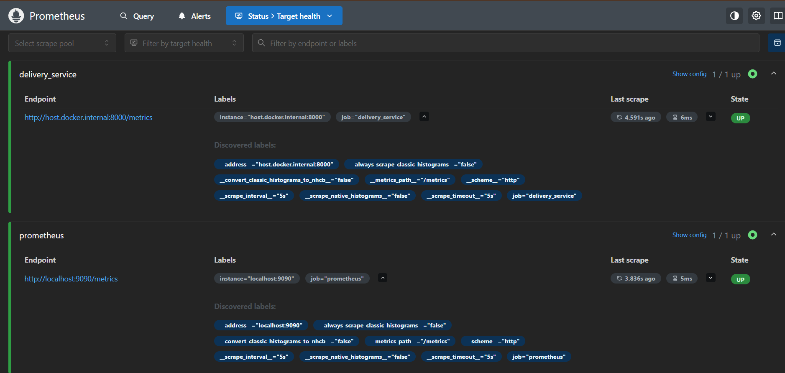
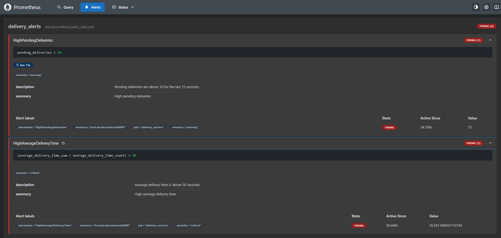
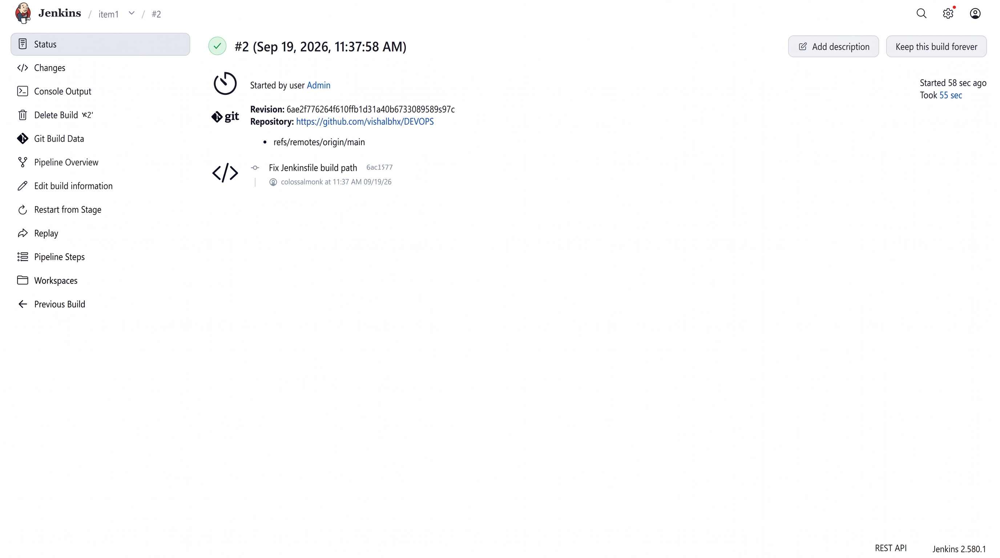
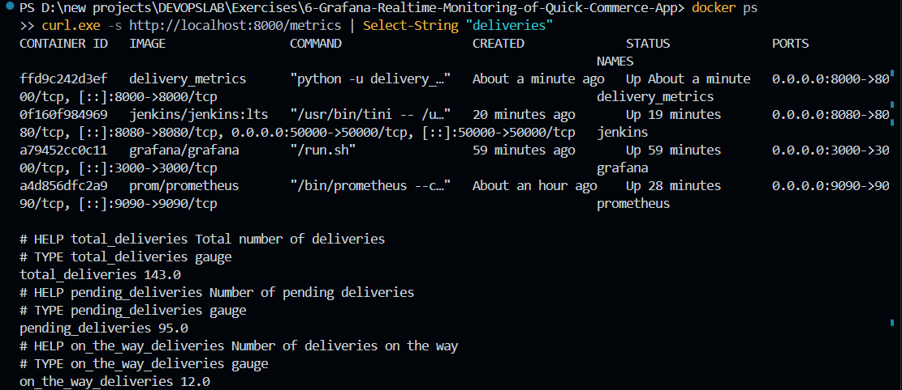

# Real-Time Telemetry & Observability Pipeline for Quick-Commerce with Prometheus, Grafana & Jenkins

## Project Overview

This engineering project demonstrates an end-to-end cloud-native observability stack built to monitor logistics operations for an on-demand quick-commerce platform (e.g., Blinkit, Zepto, Swiggy Instamart). 

The telemetry pipeline consists of:
1. **Instrumented Microservice**: A Python backend using `prometheus_client` generating operational delivery metrics.
2. **Prometheus Time-Series Scraper & Alert Engine**: Pulling metric vectors every second and triggering alert states based on SLA violations.
3. **Grafana Analytics Dashboard**: Querying Prometheus via PromQL and rendering real-time executive monitoring panels.
4. **Automated CI/CD via Jenkins**: Deploying the containerized metrics service automatically using a Declarative Pipeline running on Docker-in-Docker socket mounting.

---

## Infrastructure & Environment Specifications

| Component | Technology | Version / Configuration |
|---|---|---|
| **Host System** | Windows 11 | Docker Desktop (WSL2 backend) |
| **Automation Server** | Jenkins LTS | Containerized (`jenkins/jenkins:lts`) |
| **Metrics Collector** | Prometheus | `prom/prometheus` (Alerting Engine) |
| **Visualization Platform** | Grafana | `grafana/grafana` (PromQL Data Source) |
| **Runtime Language** | Python 3.10+ | Package: `prometheus-client` |
| **Network Fabric** | `monitoring` | Custom Docker bridge network |

---

## Workspace Hierarchy

```text
exercise-6-grafana-realtime-monitoring-of-quick-commerce-app/
├── delivery_metrics.py     # Python application instrumented with Prometheus client
├── prometheus.yml          # Scrape target configurations and interval rules
├── alert_rules.yml         # Prometheus alert rule definitions and thresholds
├── Dockerfile              # Container recipe for the metrics microservice
├── Jenkinsfile             # Declarative Jenkins CI/CD deployment pipeline
└── screenshots/            # Verification screenshots
```

---

## Platform-Specific Architecture Notes (Windows Docker Desktop)

- **Network Routing**: Since Linux host networking (`--network=host`) behaves differently on Windows Docker Desktop, an explicit bridge network (`monitoring`) and Docker's internal host gateway alias (`host.docker.internal:host-gateway`) are configured to route scrape traffic reliably between host and containers.
- **Volume Bindings**: In PowerShell, path mappings are mounted cleanly using `${PWD}/<file>`.

---

## Step-by-Step Implementation

### 1. Launching and Validating the Telemetry Generator
Install runtime dependencies and execute the delivery simulator exposing HTTP metrics on port `8000`:

```powershell
py -m pip install prometheus-client
py delivery_metrics.py
```

The script publishes four core telemetry vectors:

| Metric Name | Prometheus Type | Semantics |
|---|---|---|
| `total_deliveries` | Gauge | Cumulative delivery orders registered |
| `pending_deliveries` | Gauge | Orders awaiting rider dispatch |
| `on_the_way_deliveries` | Gauge | In-transit orders actively dispatched |
| `average_delivery_time` | Summary | Latency summary tracking delivery duration in seconds |

From a secondary terminal, query the exposed `/metrics` endpoint:

```powershell
curl.exe -s http://localhost:8000/metrics | Select-String "deliveries|average_delivery"
```

*Verification:* The endpoint returns formatted Prometheus exposition data, with latency calculating to roughly 32 seconds (`sum / count`):


---

### 2. Prometheus Provisioning & Scrape Target Resolution
Create the bridge network and initiate the Prometheus container with mounted configurations and host gateway resolution:

```powershell
docker network create monitoring

docker run -d --name prometheus --network monitoring -p 9090:9090 `
  --add-host=host.docker.internal:host-gateway `
  -v "${PWD}/prometheus.yml:/etc/prometheus/prometheus.yml" `
  -v "${PWD}/alert_rules.yml:/etc/prometheus/alert_rules.yml" `
  prom/prometheus
```

Navigate to `http://localhost:9090/targets` to confirm target discovery. Both endpoints confirm state **UP**:
- `delivery_service` (`http://host.docker.internal:8000/metrics`)
- `prometheus` (`http://localhost:9090/metrics`)



---

### 3. Alert Rule Validation
Alert logic is codified in `alert_rules.yml` evaluating two operational failure modes:

| Alert Identifier | PromQL Expression | Duration | Severity |
|---|---|---|---|
| `HighPendingDeliveries` | `pending_deliveries > 10` | `15s` | `warning` |
| `HighAverageDeliveryTime` | `(average_delivery_time_sum / average_delivery_time_count) > 30` | Instantaneous | `critical` |

Navigate to `http://localhost:9090/alerts`. Under initial baseline traffic parameters, both alerts transition to **FIRING** as thresholds are breached:



---

### 4. Grafana Visual Dashboard Construction
Deploy Grafana onto the shared `monitoring` network:

```powershell
docker run -d --name grafana --network monitoring -p 3000:3000 grafana/grafana
```

1. Access the web interface at `http://localhost:3000` (Default credentials: `admin` / `admin`).
2. Add Prometheus as the Data Source connecting to internal DNS: `http://prometheus:9090`.
3. Construct an operational logistics dashboard featuring four synchronized panels:

| Panel Title | PromQL Metric Query | Visualization Type |
|---|---|---|
| **Total Deliveries** | `total_deliveries` | Stat / Counter |
| **Pending Deliveries** | `pending_deliveries` | Gauge / Time series |
| **On-The-Way Deliveries** | `on_the_way_deliveries` | Gauge / Time series |
| **Average Delivery Time** | `average_delivery_time_sum / average_delivery_time_count` | Stat / Threshold Gauge |

*Live Metrics Dashboard:* Displays real-time order volume, active courier dispatch numbers, and SLA fulfillment times:


---

### 5. Stress Simulation & Dynamic Alert Clearing
Simulate a surge in fulfillment backlog by adjusting the pending delivery distribution range within `delivery_metrics.py` to `random.randint(50, 100)`:

```powershell
(Get-Content delivery_metrics.py) -replace 'random.randint\(10, 20\)', 'random.randint(50, 100)' | Set-Content delivery_metrics.py
docker restart prometheus
py delivery_metrics.py
```

*Resulting Alert Behavior:*
- `HighPendingDeliveries` escalates deeper into **FIRING** (value `78`).
- `HighAverageDeliveryTime` transitions to **INACTIVE** as the average delivery duration dips below the 30-second threshold.


---

### 6. Automated Continuous Deployment Pipeline with Jenkins
Deploy Jenkins with host Docker socket passthrough to automate container image build and execution:

```powershell
docker run -d --name jenkins -p 8080:8080 -p 50000:50000 `
  -v jenkins_home:/var/jenkins_home `
  -v //var/run/docker.sock:/var/run/docker.sock `
  --user root jenkins/jenkins:lts

docker exec -u root jenkins bash -c "apt-get update && apt-get install -y docker.io"
docker exec jenkins cat /var/jenkins_home/secrets/initialAdminPassword
```

#### Pipeline Configuration:
- **Project Type**: Pipeline from SCM (Git)
- **Branch**: `*/main`
- **Jenkinsfile Path**: `exercise-6-grafana-realtime-monitoring-of-quick-commerce-app/Jenkinsfile`

#### Troubleshooting Workspace Context:
During initial pipeline execution, Docker builds failed with `open Dockerfile: no such file or directory` because Jenkins evaluates steps from repository root. Wrapping the build stage with directory scoping resolved the build context:

```groovy
stage('Build Docker Image') {
    steps {
        dir('exercise-6-grafana-realtime-monitoring-of-quick-commerce-app') {
            sh 'docker build -t delivery_metrics .'
        }
    }
}
```

The build executed with status **SUCCESS**:



---

### 7. Unified Container Stack Inspection
Verify all operational containers and query active telemetry:

```powershell
docker ps
curl.exe -s http://localhost:8000/metrics | Select-String "deliveries"
```

All four production containers (`delivery_metrics`, `jenkins`, `grafana`, and `prometheus`) run concurrently on the Docker engine:



---

## Architectural Data Flow

```text
Logistics Service Container (delivery_metrics:8000)
                     │
          HTTP Pull (/metrics endpoint)
                     │
                     ▼
          Prometheus Engine (:9090)
            ├── Persistent Time Series TSDB
            └── Alert Rules Engine (Warning & Critical States)
                     │
          PromQL API Queries (:9090)
                     │
                     ▼
          Grafana Dashboard (:3000)
           (Executive Operations Monitoring)
```

---

## Comprehensive Command Reference

```powershell
# 1. Local telemetry smoke test
py -m pip install prometheus-client
py delivery_metrics.py
curl.exe -s http://localhost:8000/metrics | Select-String "deliveries|average_delivery"

# 2. Monitoring infrastructure startup
docker network create monitoring
docker run -d --name prometheus --network monitoring -p 9090:9090 `
  --add-host=host.docker.internal:host-gateway `
  -v "${PWD}/prometheus.yml:/etc/prometheus/prometheus.yml" `
  -v "${PWD}/alert_rules.yml:/etc/prometheus/alert_rules.yml" `
  prom/prometheus

docker run -d --name grafana --network monitoring -p 3000:3000 grafana/grafana

# 3. CI/CD automation deployment
docker run -d --name jenkins -p 8080:8080 -p 50000:50000 `
  -v jenkins_home:/var/jenkins_home `
  -v //var/run/docker.sock:/var/run/docker.sock `
  --user root jenkins/jenkins:lts

docker exec -u root jenkins bash -c "apt-get update && apt-get install -y docker.io"
docker ps
```

---

## Conclusion
Successfully engineered a real-time observability and delivery alerting framework. Key achievements include telemetry instrumentation using the Prometheus client, automated threshold alert evaluation, executive dashboard creation in Grafana, and continuous automated container delivery using a Docker-enabled Jenkins pipeline.