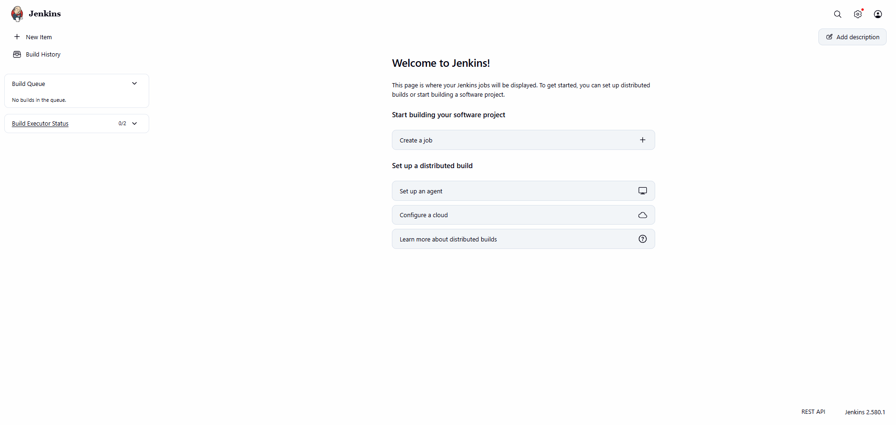

# Continuous Integration Fundamentals: Installing & Initializing Jenkins via Docker

## Project Overview

This lab introduces the architectural fundamentals of Continuous Integration (CI) and walks through provisioning, unlocking, and initializing an automated CI/CD controller using the official Long-Term Support (LTS) Jenkins Docker container on Windows 11.

---

## Technical Specifications

| Parameter | Configuration Detail |
|---|---|
| **Host System** | Windows 11 |
| **Execution Shell** | PowerShell (Terminal) |
| **Container Engine** | Docker Engine (Docker Desktop) |
| **Jenkins Image** | `jenkins/jenkins:lts` |
| **Installed Version** | Jenkins 2.580.1 |
| **Web UI Endpoint** | `http://localhost:8080` |
| **JNLP Agent Port** | `50000` (Inbound Agent Traffic) |

---

## Continuous Integration (CI) Principles & Architecture

Continuous Integration is an agile software engineering methodology where development teams merge code updates into a centralized trunk multiple times per day. Every commit triggers automated build compilation, linting, and automated unit/integration test suites.

### Core Architectural Advantages:
- **Shift-Left Defect Detection**: Uncovers integration conflicts, broken builds, and regression errors minutes after commit submission.
- **Rapid Delivery Cycles**: Minimizes merge overhead and eliminates prolonged stabilization phases before production releases.
- **Enhanced Code Quality**: Guarantees that code passing into the repository meets automated quality gates.

---

## Core Jenkins Platform Terminology

- **Controller (Master Node)**: Coordinates scheduling, maintains configuration state, hosts the UI, and tracks build telemetry.
- **Build Agents (Worker Nodes)**: Dedicated worker instances executing discrete stages dispatched by the controller.
- **Item / Job**: A discrete automation task defined within Jenkins (Freestyle project, Pipeline, Multibranch).
- **Pipeline**: A codified sequence of delivery stages (Build, Test, Stage, Deploy) expressed via a `Jenkinsfile`.
- **Plugins**: Extensible modules augmenting Jenkins capabilities (SCM integration, Docker engines, security realms).

---

## Step-by-Step Implementation

### 1. Provisioning the Jenkins Container
Launch the containerized Jenkins controller in detached mode, exposing the HTTP interface and the agent remoting port:

```powershell
docker run -d --name jenkins -p 8080:8080 -p 50000:50000 jenkins/jenkins:lts
```

*Port Designations:*
- `8080`: Primary HTTP web listener serving the Jenkins management console.
- `50000`: Java Network Launch Protocol (JNLP) port for distributed build agent communication.

---

### 2. Runtime Health Verification
Confirm the container process is active and ports are successfully bound:

```powershell
docker ps
```

*Status Check:* Verifies that `jenkins` is `Up` and routing `0.0.0.0:8080->8080/tcp` and `0.0.0.0:50000->50000/tcp`.

---

### 3. Extracting Initial Security Credentials
During initial bootstrap, Jenkins generates an ephemeral master secret within the container's home directory. Retrieve this key via `docker exec`:

```powershell
docker exec jenkins cat /var/jenkins_home/secrets/initialAdminPassword
```

The command yields the master unlock token required for administrative onboarding.

---

### 4. Accessing the Web Interface
Launch the browser to interface with the controller:

```powershell
Start-Process "http://localhost:8080"
```

The browser successfully connects to the local Jenkins listener:


---

### 5. Controller Authentication & Unlocking
The initial security onboarding screen prompts for the admin key located at `/var/jenkins_home/secrets/initialAdminPassword`. Supply the token retrieved in Step 3 to proceed:


---

### 6. Completing Setup Wizard
Proceed through the initial installation flow. By bypassing custom administrator creation, standard administrative access persists under user `admin` paired with the initial bootstrap secret.

The wizard concludes with confirmation: **"Jenkins is ready!"**


---

### 7. Administrative Console Inspection
Click **Start using Jenkins** to enter the primary administrative dashboard:

- **Navigation**: Access controls for *New Item*, *Build History*, *Manage Jenkins*, and *Credentials*.
- **Executor Status**: 2 default local build executors active and available.
- **Build Queue**: Idle, ready to accept automation jobs.
- **Platform Version**: Jenkins v2.580.1.



---

## Continuous Integration Workflow Flowchart

```text
Developer Push
      │
      ▼
Source Code Management (GitHub / GitLab)
      │
      ▼ (Webhook Trigger)
Jenkins Automation Controller
      ├── Checkout Workspace
      ├── Compile Code & Dependencies
      ├── Execute Unit & Integration Tests
      └── Package Container Image
      │
      ▼
Feedback Engine (Slack / GitHub Checks / Email)
```

---

## Complete Command Summary

```powershell
# 1. Start Jenkins container
docker run -d --name jenkins -p 8080:8080 -p 50000:50000 jenkins/jenkins:lts

# 2. Check container status
docker ps

# 3. Retrieve administrative token
docker exec jenkins cat /var/jenkins_home/secrets/initialAdminPassword

# 4. Open dashboard in browser
Start-Process "http://localhost:8080"
```

---

## Results & Verification
- Deployed a containerized Jenkins CI/CD controller on Windows 11 using Docker Desktop.
- Handled network port mapping for administrative access (`8080`) and agent coordination (`50000`).
- Retrieved the initial administrative unlock secret via container execution commands.
- Successfully completed the installation wizard and validated access to the core Jenkins management interface.