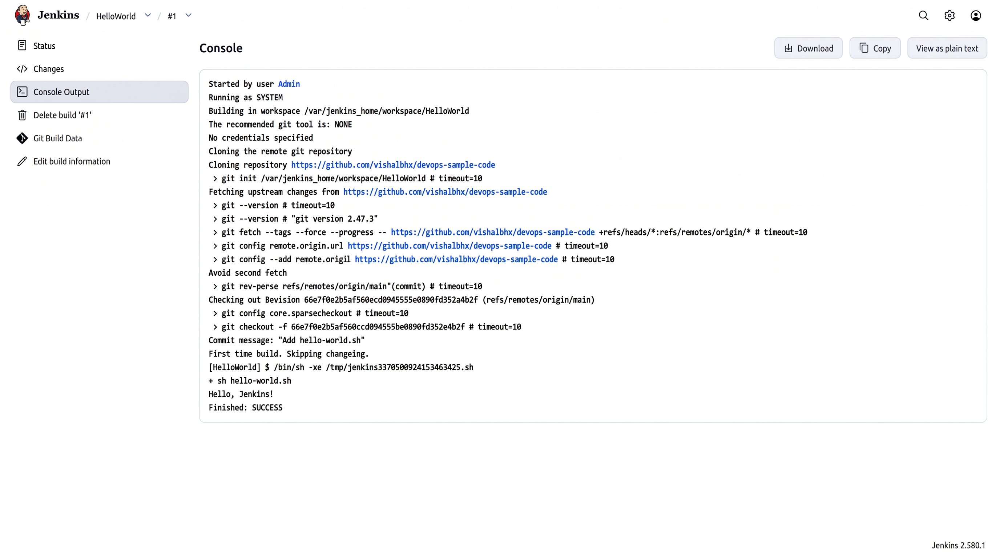

# Automated Build Execution: Creating a Jenkins Freestyle CI Job

## Project Overview

This project demonstrates the creation and execution of an automated CI build job using Jenkins. We configure a containerized Jenkins server backed by persistent volume storage, connect it to a remote Git version control repository containing executable automation scripts, and implement a **Freestyle Project** that pulls the latest source code and executes automated shell tasks upon invocation.

---

## Technical Specifications

| Parameter | Specification |
|---|---|
| **Host Environment** | Windows 11 |
| **Container Engine** | Docker Desktop |
| **CI Automation Server** | Jenkins LTS (`jenkins/jenkins:lts`) |
| **Version Control System** | Git / GitHub SCM integration |
| **Target Job Type** | Freestyle Project |
| **Target Script** | `hello-world.sh` |

---

## Remote SCM Target Configuration

The automated pipeline connects to a sample Git repository (`devops-sample-code`) housing the target execution script:

**Script Manifest (`hello-world.sh`):**
```bash
#!/bin/bash
echo "Hello, Jenkins!"
```

---

## Step-by-Step Implementation

### 1. Initializing Jenkins with Persistent Storage
To ensure build history, workspace configurations, and installed plugins survive container lifecycle restarts, launch the Jenkins controller mounting a named Docker volume (`jenkins_home`):

```powershell
docker rm -f jenkins
docker volume rm jenkins_home
docker run -d --name jenkins -p 8080:8080 -p 50000:50000 -v jenkins_home:/var/jenkins_home jenkins/jenkins:lts
```

Verify runtime health and port bindings:

```powershell
docker ps
```

Retrieve the bootstrap administrator key from the container mount:

```powershell
docker exec jenkins cat /var/jenkins_home/secrets/initialAdminPassword
```

Using this secret, unlock the controller at `http://localhost:8080`, finalize plugin installation (Git, SCM, Pipeline plugins), and establish administrative access:


---

### 2. Creating a New Automation Job
Navigate to the Jenkins main console:

1. Click **New Item** on the primary navigation sidebar.
2. Enter the project identifier: `HelloWorld`.
3. Choose **Freestyle project** as the item type (standard for standalone automation scripts and single-stage tasks).
4. Click **OK** to open the job configuration canvas.


---

### 3. Codifying Job Configuration & SCM Binding

#### General Details
- **Description**: `Hello World! Jenkins job.`

#### Source Code Management (SCM)
- Select **Git**.
- **Repository URL**: `https://github.com/lakshyaaa76/devops-sample-code.git`
- **Branch Specifier**: `*/main` (targets production/default branch).

#### Build Environment & Steps
1. Under **Build Steps**, select **Add build step → Execute shell**.
2. Specify the invocation command:
   ```bash
   sh hello-world.sh
   ```
3. Click **Save** to commit the job definition.

---

### 4. Triggering the Build & Verifying Console Logs
On the `HelloWorld` project view, select **Build Now** to trigger an instantaneous build run. Build `#1` registers under **Build History**.

Inspect the detailed execution telemetry via **Console Output**:

```text
Started by user admin
Running as SYSTEM
Building in workspace /var/jenkins_home/workspace/HelloWorld
The recommended git tool is: NONE(PATH)
Using reference repository: /var/jenkins_home/caches/git-...
Cloning the remote Git repository
Cloning repository https://github.com/lakshyaaa76/devops-sample-code.git
 > git init /var/jenkins_home/workspace/HelloWorld
 > git fetch --tags --force --progress -- https://github.com/lakshyaaa76/devops-sample-code.git +refs/heads/*:refs/remotes/origin/*
 > git config remote.origin.url https://github.com/lakshyaaa76/devops-sample-code.git
 > git config --add remote.origin.fetch +refs/heads/*:refs/remotes/origin/*
Checking out Revision 66ef70e (refs/remotes/origin/main)
 > git checkout -f 66ef70e
Commit message: "Add hello-world.sh"
[HelloWorld] $ /bin/sh -xe /tmp/jenkins8405072049817921825.sh
+ sh hello-world.sh
Hello, Jenkins!
Finished: SUCCESS
```

*Verification:* The Git integration plugin successfully cloned the remote repository into `/var/jenkins_home/workspace/HelloWorld`, checked out commit `66ef70e`, executed `hello-world.sh`, and exited with status `SUCCESS` (exit code 0):



---

## Architectural Execution Flow

```text
Jenkins Freestyle Job (HelloWorld) Triggered
                  │
                  ▼
Git SCM Plugin initiates remote clone
                  │
                  ▼
Clones repository into workspace:
`/var/jenkins_home/workspace/HelloWorld`
                  │
                  ▼
Jenkins executes shell runner:
`sh hello-world.sh`
                  │
                  ▼
Standard Output Captured: "Hello, Jenkins!"
Exit Code: 0 (Status: SUCCESS)
```

- **Workspace Isolation**: Each job executes within an isolated filesystem sandbox (`workspace/<job-name>`).
- **SCM Synchronization**: Commits are pulled down into the workspace prior to executing build steps.
- **Exit Code Mediation**: Jenkins monitors standard process exit codes (`0` indicates success, non-zero triggers build failure).

---

## Complete Command Log

```powershell
# 1. Reset and initialize Jenkins container with persistent storage
docker rm -f jenkins
docker volume rm jenkins_home
docker run -d --name jenkins -p 8080:8080 -p 50000:50000 -v jenkins_home:/var/jenkins_home jenkins/jenkins:lts

# 2. Check container status
docker ps

# 3. Retrieve administrative token
docker exec jenkins cat /var/jenkins_home/secrets/initialAdminPassword
```

---

## Conclusion
Successfully deployed a persistent Jenkins controller, established remote Git SCM repository integration, and configured an automated Freestyle build job. Verified end-to-end repository cloning, script execution, and standard console output logging with status `SUCCESS`.